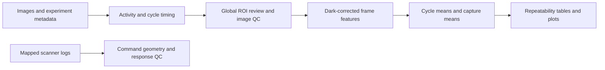
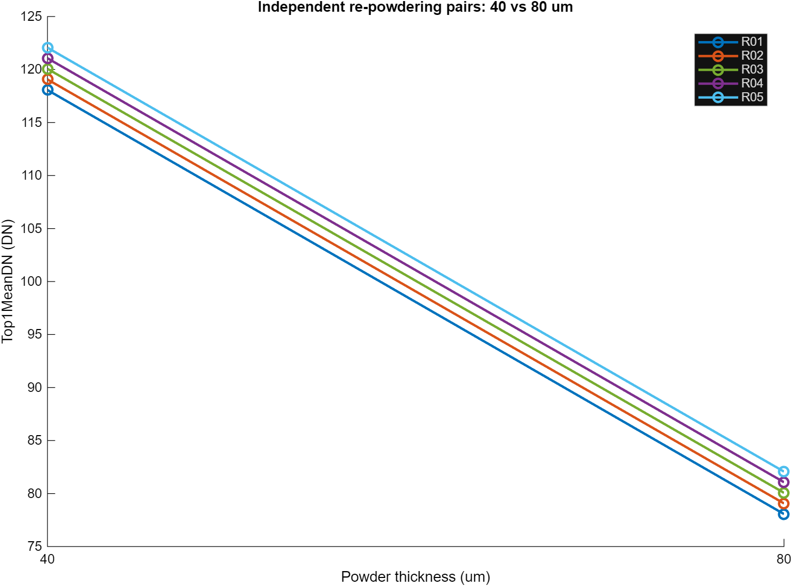

# SLM CircleScan Analysis

MATLAB tools for CircleScan image activity detection, dark-corrected brightness features, quality checks, and repeatability analysis in powder-bed monitoring research.

這個專案把一組掃描影像整理成可追溯的分析結果：找出有效區間、檢查固定 ROI 與曝光、計算亮度特徵，再區分同床重拍與跨實驗單位的變異。目前公開版包含分析程式與可執行的合成範例。

## Workflow



## Quick start — synthetic software demonstration

Validated with **MATLAB R2025b** on Windows. Dependency analysis of the 27 production files identified MATLAB, with no additional MathWorks toolbox products reported in this environment. The minimum supported MATLAB release has not been established.

From the repository root in MATLAB:

```matlab
addpath(fullfile(pwd, 'examples'));
result = run_synthetic_demo();
```

The demo generates its own tiny images and motion log under a unique temporary folder. No research images, machine connection, downloads, or credentials are needed. It prints the output location and restores the caller's MATLAB path when it returns.

The publication check on 2026-10-19 completed 30 synthetic datasets, produced 240 capture-feature rows and five plots, and verified failure isolation and test-path restoration. See [validation details](docs/VALIDATION.md) and [demo coverage](examples/README.md).

**The following plot is generated from deliberately constructed synthetic software-test inputs. It is not an experimental powder-thickness result.**



The synthetic test replaces activity detection with a test double and supplies fixed cycle windows, a synthetic ROI approval and some QC/status records. It does not run the entire real-image pipeline end to end.

## Repository contents

| Location | Purpose |
| --- | --- |
| [Matlab_Code/detect_circle_scan_interval.m](Matlab_Code/detect_circle_scan_interval.m) | Shared real image-activity/cycle detector |
| [Matlab_Code/STAGE3_V2](Matlab_Code/STAGE3_V2/) | 15 top-level workflow/plotting functions and 11 package helpers |
| [Matlab_Code/STAGE3_V2/tests](Matlab_Code/STAGE3_V2/tests/) | Synthetic smoke test and isolated fake detector |
| [examples](examples/) | Runnable synthetic entry point and scope |
| [docs/METHOD.md](docs/METHOD.md) | Feature definitions and aggregation |
| [docs/LIMITATIONS.md](docs/LIMITATIONS.md) | Evidence boundaries and follow-up validation |

For your own images, start with the [V2 workflow guide](Matlab_Code/STAGE3_V2/README_STAGE3_V2.md). Add only `Matlab_Code` and `Matlab_Code/STAGE3_V2` to the production MATLAB path. **Do not use `addpath(genpath(...))`**, which would also expose the test double.

## Contribution and publication scope

This repository presents the SLM/CircleScan research analysis workflow of GitHub user [huaien418](https://github.com/huaien418). See [contributions and AI assistance](CONTRIBUTIONS.md) and [publication changes](docs/PUBLICATION_CHANGES.md).

The public copy retains all 27 original production `.m` files byte-for-byte. The existing smoke test has one publication change: restoring the caller path with `onCleanup`; a new demo wrapper checks that isolation. Research images, real experiment tables, machine-control code, original MATLAB config/approval files, and legacy scripts are not part of this first release.

The software analyzes image evidence and supports research review. It does not by itself establish a calibrated thickness map, defect-detection accuracy on unseen powder beds, scanner/camera synchronization, or laser power compensation.
